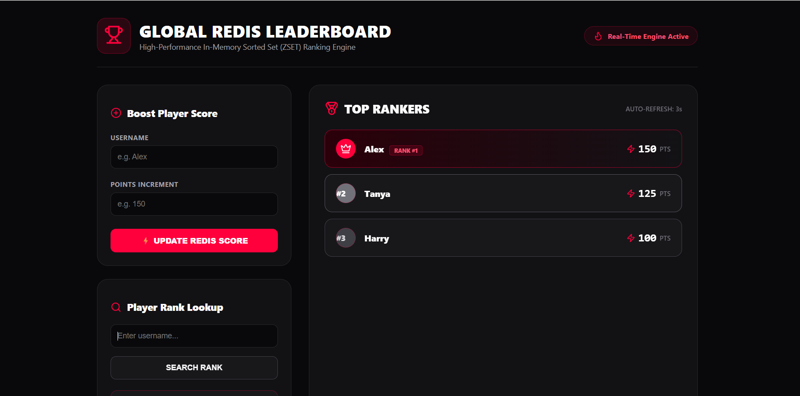

# 🚀 Real-Time Leaderboard System (Redis + Docker + React)

A high-performance, real-time leaderboard application designed to handle instant score submissions, dynamic rank recalculations, and low-latency global user lookups using **Redis Sorted Sets (ZSETs)**, **Node.js/Express**, **React (Vite)**, and **Docker**.

## 📌 Live Demo

- **Frontend Application:** [View Live App](https://redis-leaderboard-ten.vercel.app/)
- **Backend API Service:** [View Backend API](https://redis-leaderboard.onrender.com)

<p align="center">
  
</p>


## 🎯 Problem Statement & Why Redis?

In modern competitive gaming, live sports, and streaming platforms, dynamically recalculating user ranks using traditional relational databases like MySQL or PostgreSQL can become a performance bottleneck.

For example, executing SQL queries across millions of records:

```sql
SELECT
    username,
    score,
    RANK() OVER (ORDER BY score DESC)
FROM users;
```

Such queries can introduce significant CPU overhead and query latency as the dataset grows.

### 💡 The Redis Solution

Redis solves real-time ranking efficiently using **Sorted Sets (ZSETs)**.

- **In-Memory Speed:** Stores and processes data in memory for low-latency operations.
- **Efficient Ranking:** Sorted Set insertions and rank lookups typically take `O(log N)` time.
- **Automatic Ordering:** Redis maintains sorted order as scores are added or updated using commands such as `ZADD` and `ZINCRBY`.
- **Scalable Lookups:** Retrieve top-ranked users and individual player positions without manually sorting the entire dataset in application code.

## ✨ Features

- ⚡ **Real-Time Rank Recalculation:** Updates player rankings immediately when scores change.
- 🏆 **Global Leaderboard View:** Retrieves top players in descending order of scores using `ZREVRANGE`.
- 🔍 **Instant User Lookup:** Finds a user's current score and global rank using `ZSCORE` and `ZREVRANK`.
- 🐳 **Dockerized Architecture:** Supports running the application and local Redis instance through Docker Compose.
- ☁️ **Cloud-Ready Deployment:** Uses managed cloud Redis through Upstash for production deployment.
- 🚀 **REST API Integration:** Connects the React frontend to the Express backend through HTTP endpoints.

## 🛠️ Tech Stack

| Component | Technology |
|---|---|
| Frontend | React.js, Vite |
| Styling | Tailwind CSS, Lucide Icons |
| Backend | Node.js, Express.js |
| Redis Client | ioredis / Redis SDK |
| Database | Redis Sorted Sets (ZSETs) |
| Cloud Redis | Upstash |
| Containerization | Docker, Docker Compose |
| Frontend Deployment | Vercel |
| Backend Deployment | Render |

## 🏗️ System Architecture

```text
             ┌──────────────────────┐
             │    React Frontend    │
             │     (Vercel)         │
             └──────────┬───────────┘
                        │ HTTP Requests
                        ▼
             ┌──────────────────────┐
             │   Express REST API   │
             │      (Render)        │
             └──────────┬───────────┘
                        │ Redis Commands
                        ▼
             ┌──────────────────────┐
             │    Redis Sorted Set  │
             │      (Upstash)       │
             └──────────────────────┘
```

### Request Flow

**1. Write Path — Submit Score**

The client sends a username and score to the backend:

```http
POST /api/leaderboard
```

Example request body:

```json
{
  "username": "player1",
  "score": 1500
}
```

The backend updates the user's score in Redis:

```redis
ZADD leaderboard 1500 player1
```

**2. Read Path — Fetch Top Players**

The client requests the leaderboard:

```http
GET /api/leaderboard
```

Redis retrieves the top 10 players in descending score order:

```redis
ZREVRANGE leaderboard 0 9 WITHSCORES
```

**3. Rank Search — Find a User**

The client requests a specific user's rank:

```http
GET /api/leaderboard/rank/:username
```

The backend uses:

```redis
ZREVRANK leaderboard player1
ZSCORE leaderboard player1
```

Redis returns the user's zero-based rank and current score.

## ⚡ Redis Commands & Time Complexity

Let `N` represent the number of users and `M` the number of returned entries.

| Operation | Redis Command | Time Complexity |
|---|---|---|
| Add or update score | `ZADD leaderboard <score> <username>` | `O(log N)` |
| Fetch top players | `ZREVRANGE leaderboard 0 <end> WITHSCORES` | `O(log N + M)` |
| Get user rank | `ZREVRANK leaderboard <username>` | `O(log N)` |
| Get user score | `ZSCORE leaderboard <username>` | `O(1)` |

**Note:** Redis uses sorted-set data structures to maintain score-based ordering. Rank positions are zero-based, so the highest-ranked user has rank `0`.

## 💻 Local Development Setup

### Prerequisites

Make sure you have the following installed:

- [Git](https://git-scm.com/)
- [Node.js (v18 or later)](https://nodejs.org/)
- [Docker](https://www.docker.com/)
- Docker Compose

### 1. Clone the Repository

```bash
git clone https://github.com/your-username/redis-leaderboard.git
cd redis-leaderboard
```

**Important:** Replace `your-username` with the actual GitHub username and repository URL before using this command.

### 2. Start the Application Using Docker Compose

Run the following command from the project root directory:

```bash
docker-compose up --build
```

This builds and starts the configured frontend, backend, and local Redis services.

### 3. Access the Services

Once the containers are running, access the services at their configured local addresses:

- **Frontend:** http://localhost:3000
- **Backend API:** http://localhost:5000
- **Local Redis:** localhost:6379

*Note: These ports assume the corresponding mappings are configured in your Docker Compose file.*

## 🌐 Real-World Use Cases of Redis

Redis supports several high-performance application use cases beyond leaderboards.

### 1. Distributed Caching
Stores frequently accessed data in memory to reduce database load and improve response times.

### 2. Session Management
Stores session data used in authentication and user session management.

### 3. API Rate Limiting
Uses commands such as `INCR` and `EXPIRE` to track request counts and help protect APIs from excessive traffic.

### 4. Pub/Sub and Event-Driven Systems
Enables lightweight message broadcasting and real-time notifications using Redis Pub/Sub.

## 🤝 Contributing

Contributions, issues, and feature requests are welcome!

1. Fork the repository.
2. Create a new feature branch.
3. Commit your changes.
4. Push the branch to your fork.
5. Open a pull request.

## 📝 License

This project is licensed under the MIT License.

---

**Built with ❤️ using React, Node.js, Redis, and Docker.**
